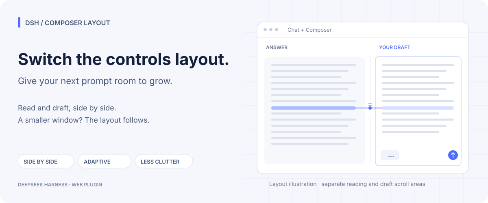
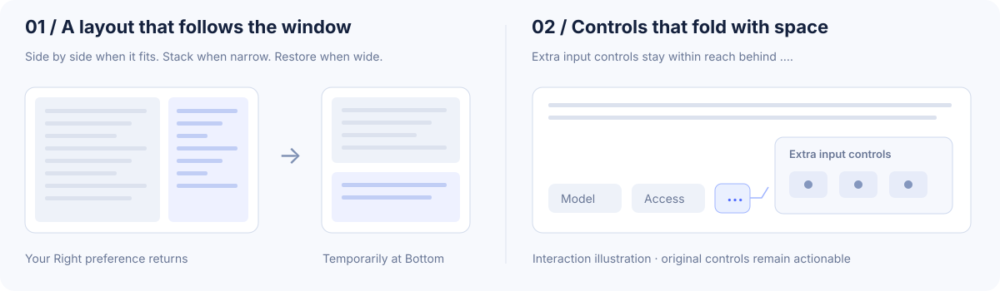
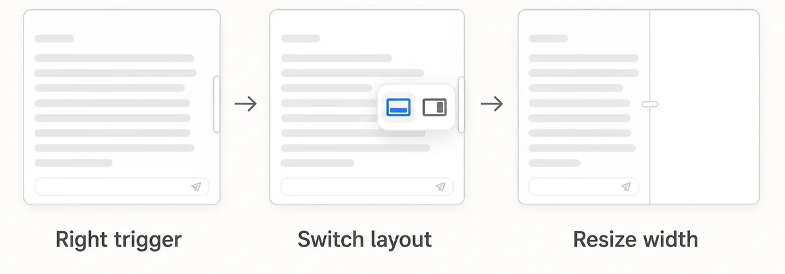

<p align="center">
  
</p>

<h1 align="center">DSH Composer Layout</h1>

<p align="center"><strong>Switch the controls layout.</strong><br>A dockable Composer for <a href="https://github.com/deepseek-ai/deepseek-harness">DeepSeek Harness</a> Web.</p>

<p align="center">
  <a href="https://www.npmjs.com/package/dsh-composer-layout"></a>
  <a href="https://github.com/lavapapa/dsh-composer-layout/tags"></a>
  <a href="LICENSE"></a>
</p>

<p align="center"><strong>English</strong> · <a href="README.zh.md">简体中文</a></p>
<p align="center"><a href="#features">Features</a> · <a href="#install">Install</a> · <a href="#use-it-in-dsh">Usage</a> · <a href="CHANGELOG.md">Changelog</a></p>



Long answers and detailed prompts deserve their own space. Dock Composer to the right to reference an answer while shaping your next message; keep it at the bottom for compact conversations, or let Automatic choose as the window changes. Models, permissions, sessions, tools, and token accounting continue to use DSH's native behavior.

## Features

Three small layout changes make the reading-and-writing workflow easier to manage:

<table>
  <tr>
    <td width="33%" valign="top"><strong>↔ Side-by-side drafting</strong><br><br>Give the answer and draft separate vertical space. Drag the divider to set their balance; scroll a long draft independently.</td>
    <td width="33%" valign="top"><strong>▥ Adaptive layout</strong><br><br>Choose Bottom, Right, or Automatic. Narrow windows temporarily stack the panes; your Right preference returns when they fit again.</td>
    <td width="33%" valign="top"><strong>… Space-aware controls</strong><br><br>In Bottom and Right layouts, overflowing third-party input controls fold into a <code>…</code> popup, keeping their actions within reach.</td>
  </tr>
</table>



**More everyday details:**

- **Per-session memory.** With “Remember this session layout” enabled, each session keeps its placement and manually resized right-pane width in this browser.
- **Native editing.** The right-side editor fills the available input surface, including the blank area below a short draft, and retains native text selection.
- **Reachable pickers.** Slash and file-reference candidates stay inside the side pane. Opening another Composer popup closes those candidates first.
- **Your preferred width.** Choose a narrow, medium, or wide default right pane; fine-tune it with the divider.

See the [changelog](CHANGELOG.md) for version differences. Entries marked **Unpublished** describe development previews.

## Install

Use your intended Web profile in place of `web`. The npm package includes the prebuilt plugin bundle.

```sh
dsh plugin --profile web add dsh-composer-layout@latest
```

Follow the plugin manager's loading instructions. If it reports that a restart is needed, restart the target Web service using its usual launch method and refresh the page. Then open **Settings → Built-in plugins → Composer Layout** and choose **Right** or **Automatic**. If you launch DSH manually:

```sh
dsh web --profile web
```

Check the published version with `npm view dsh-composer-layout version`. Confirm the bundle is in the intended profile with `dsh --profile web --dump-config`. For dependency declarations, see [`package.json`](package.json).

<details>
<summary><strong>Install directly from GitHub</strong></summary>

### Install directly from GitHub

Choose a [published release tag](https://github.com/lavapapa/dsh-composer-layout/tags) that matches your DSH version; supported ranges are declared in `peerDependencies` in [`package.json`](package.json). Replace `<release-tag>` below with that tag:

```sh
dsh plugin --profile web add "github:lavapapa/dsh-composer-layout#<release-tag>"
```

The repository includes the host and browser artifacts needed for GitHub installs. Follow the plugin manager's loading instructions; if a restart is needed, use the target service's usual launch method and refresh its page.

</details>

<details>
<summary><strong>Update an existing installation</strong></summary>

Stop the Web service using that profile with its usual service controls, then check the npm version and replace the plugin in the same profile:

```sh
npm view dsh-composer-layout version
dsh plugin --profile web remove dsh-composer-layout
dsh plugin --profile web add dsh-composer-layout@latest
```

Start the target Web service again with its usual launch method and refresh the page.

</details>

## Use it in DSH

Set your default in **Settings → Built-in plugins → Composer Layout**, or use the rail at the conversation's right edge to switch between Bottom and Right. In Right layout, drag the divider to resize the Composer pane.



| Mode | When to use it | Behavior |
| --- | --- | --- |
| **Bottom** | Short messages or a narrow window | DSH's compact bottom editor. |
| **Right** | Read a long answer while drafting a detailed prompt | Two columns when they fit; temporary Bottom layout when space runs out. |
| **Automatic** | Change window size often | Uses the conversation main area's width-to-height ratio and the minimum width needed by both columns. |

The Automatic threshold is editable in the plugin settings. Enable session memory to keep each conversation's layout and width. The Home/new-session screen retains DSH's native layout.

<details>
<summary><strong>Transcript width in Right layout</strong></summary>

Chat uses the available left-column width; the plugin divider adjusts its reading space. DSH's two native transcript-width handles are hidden in Right layout. Returning to Bottom restores those handles and preserves DSH's saved width preference.

</details>

## Development

The [changelog](CHANGELOG.md) separates published work from development previews. Its scroll/overflow entries cover native reading-position restoration, extra-control folding in Bottom, native menu surfaces and positioning, original control sizing, and unclipped inline tooltips. Check the corresponding release entry before expecting those refinements in an npm installation.

The plugin owns its implementation under [`src/`](src/) and commits the generated [`lib/`](lib/) artifacts used by GitHub installs. Before publishing:

```sh
pnpm typecheck
pnpm build
pnpm test
pnpm test:dsh-matrix
```

For contributions, see [CONTRIBUTING.md](CONTRIBUTING.md).

## Community

Find the plugin in [Awesome DSH Plugin](https://github.com/awesome-dsh-plugin/awesome-dsh-plugin/blob/main/data/plugins/lavapapa__dsh-composer-layout.yml), [Awesome DeepSeek Harness Plugins](https://github.com/Zhiyuan-Fan/Awesome-DeepSeek-Harness-Plugins), [Awesome DSH Plugins](https://github.com/cccakeee/awesome-dsh-plugins/blob/main/docs/categories/web-ui.en.md), and [Oh My DSH](https://github.com/NoWint/Oh-My-DSH).

[Report a bug or suggest a feature](https://github.com/lavapapa/dsh-composer-layout/issues) · [DSH plugin topic](https://github.com/topics/dsh-plugin) · [DSH Market](https://github.com/dsh-market/dsh-market)

<p align="center"><strong>More room for the next thought.</strong><br>MIT · <a href="LICENSE">License</a></p>
