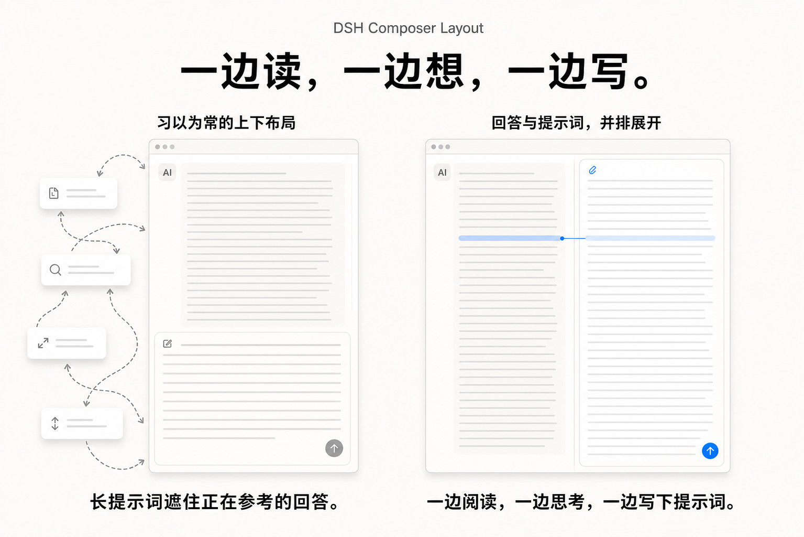

# DSH Composer Layout

[English](README.md) · **简体中文**

[](https://github.com/lavapapa/dsh-composer-layout/tags)
[](https://www.npmjs.com/package/dsh-composer-layout)
[](https://github.com/awesome-dsh-plugin/awesome-dsh-plugin/blob/main/data/plugins/lavapapa__dsh-composer-layout.yml)
[](https://github.com/Zhiyuan-Fan/Awesome-DeepSeek-Harness-Plugins)
[](https://github.com/cccakeee/awesome-dsh-plugins/blob/main/docs/categories/web-ui.md)
[](https://github.com/NoWint/Oh-My-DSH)
[](LICENSE)

[简介](#dsh-composer-layout) · [安装](#安装) · [为什么右侧布局](#为什么要把-composer-放在右侧) · [实际界面](#实际界面) · [切换与调宽](#切换与调宽) · [功能](#它增加了什么) · [验收](docs/RELEASE_CHECKS.md) · [贡献](CONTRIBUTING.md) · [English](README.md)

> **一边读，一边想，一边写。** 把 Composer 停到右侧，让回答和正在成形的提示词始终并排可见。

这是一个 [DeepSeek Harness](https://github.com/deepseek-ai/deepseek-harness) Web 插件，让 Composer 保持在底部，或停靠到右侧栏。聊天区与 Composer 各自保留空间；模型、权限、额度、会话和工具行为继续使用 DSH 原有实现。



## 为什么要把 Composer 放在右侧？

大家已经习惯了上下布局，它也确实适合回答和输入都很短的对话。但只要回答变长，或者要写一段真正复杂的指令，回答和输入就会争夺同一段纵向空间：长回答会把输入区挤远，长草稿又会把正在参考的内容推走。接下来往往只能靠补救：复制一段内容、调整输入区、向上滚回去找上下文、搜索刚刚看过的段落，然后再重复一次。

这在桌面端尤其可惜。大多数桌面显示器天生更宽，横向空间往往仍有余量；浏览器界面、不断增长的回答和草稿却只能挤在有限的纵向高度里。上下布局没有用好相对充裕的横向空间，反而把最紧张的纵向空间消耗得更快。

把 Composer 放到右侧以后，阅读和写作各自拥有稳定的纵向空间。对话再长，仍可留在左边；草稿再复杂，也能在右边展开。关键在于两者能同时留在视野里：读到一段内容，顺着它思考，就在旁边写下或修订相应的提示词，不必先丢失其中一边再找回来。这只是一个布局调整，却能消除长输入工作中反复被打断的感觉。

## 实际界面


## 切换与调宽


## 它增加了什么

- 在“**设置 → 插件 → Composer 布局**”中选择底部、右侧或自动布局。自动模式按会话主区域的宽高比切换，阈值范围为 0.5–2，默认为 1；使用右侧布局还需满足两栏的最小宽度。
- 停靠白条向左移，与 Composer 输入框边界留出距离；右侧布局下，分隔条也可以调整 Composer 栏宽度。宽度不足时，禁用的“右侧”选项会提示所需条件。
- 打开“记住当前会话布局”后，分别保存每个会话的布局，以及手动调整过的右侧栏宽度。
- 窗口装不下两个可用栏位时，暂时回到上下布局，同时保留布局手柄；宽度恢复后，记住的右侧布局会自动回来。
- 右侧布局中，打开模型、权限、上下文等 Composer 面板前会收起斜杠／引用候选，避免浮层互相遮挡；空间不足时，右栏第三方控件收进省略号浮层。
- 适配 DSH 的嵌套会话滚动容器，并在宿主容器与聊天区之间桥接滚动事件。已验证的范围与尚未完整复现的流结束时序问题见[验收说明](docs/RELEASE_CHECKS.md)。

左右布局下，正文使用左栏的可用宽度，通过插件分隔条调整阅读空间。此时隐藏 DSH 原生的两条正文调宽手柄，避免它们覆盖 Composer；该模式不提供独立的正文留白调宽。切回底部布局后，原生手柄恢复，DSH 已保存的正文宽度偏好仍然保留。

本插件只负责界面布局，不新增面向模型的工具，不改变提示词或额度统计。

## 安装

### 从 npm 安装

npm 包包含预构建好的插件 bundle。0.1.15 已在 DSH **0.1.2-rc.1** 和 **0.1.3-alpha.2** 中通过隔离兼容性测试，这两个版本的用户可以使用同一个插件包；此结论不覆盖未来的 alpha 版本。测试范围与剩余限制见[验收说明](docs/RELEASE_CHECKS.md#0115-release-evidence)。旧版 DSH 用户仍可指定 `dsh-composer-layout@0.1.12`；当前 npm 版本可用 `npm view dsh-composer-layout version` 查询。

```sh
dsh plugin --profile web add dsh-composer-layout@latest
dsh web --profile web
```

### 直接从 GitHub 安装

DSH 可以直接从 GitHub 仓库安装插件 bundle；新版本标签为 `v0.1.15`，针对 DSH 0.1.2-rc.1。旧版 DSH 用户仍可使用 `v0.1.12` 标签。

```sh
dsh plugin --profile web add "github:lavapapa/dsh-composer-layout#v0.1.15"
dsh web --profile web
```

然后打开“**设置 → 插件 → Composer 布局**”，选择“**右侧**”。DSH 不会热重载 profile patch，安装后需要重启 Web profile。

仓库已经提交 GitHub 安装所需的 Host 与浏览器产物，安装过程不需要额外执行构建。可以用下面的命令确认 bundle 已写入目标 profile：

```sh
dsh --profile web --dump-config
```

### 更新

需要更新到 npm 渠道版本时，先用 `npm view dsh-composer-layout version` 确认版本，再执行：

```sh
dsh plugin --profile web remove dsh-composer-layout
dsh plugin --profile web add dsh-composer-layout@latest
dsh web --profile web
```

依赖声明见 [`package.json`](package.json)，实际验证过的 DSH 版本见[验收说明](docs/RELEASE_CHECKS.md)；[DSH 兼容性工作流](https://github.com/lavapapa/dsh-composer-layout/actions/workflows/dsh-latest-compat.yml) 会定期用当前 DSH 版本检查插件。

## 开发

仓库有意提交了 GitHub 安装需要的 `lib/` 构建产物，插件实现由本仓库 `src/` 自己维护。发布前运行 `pnpm typecheck`、`pnpm build` 和 `pnpm test`，并在匹配版本的干净 DSH checkout 中做一次实际检查。

## 相关链接

- [DeepSeek Harness](https://github.com/deepseek-ai/deepseek-harness)
- [DSH 插件主题](https://github.com/topics/dsh-plugin)
- [Awesome DSH Plugin](https://github.com/awesome-dsh-plugin/awesome-dsh-plugin)
- [DSH Market](https://github.com/dsh-market/dsh-market)

## 许可证

MIT，详见 [`LICENSE`](LICENSE)。
