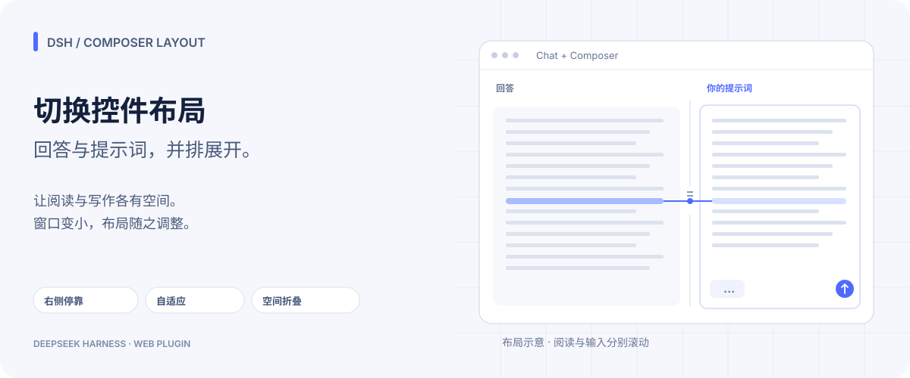

<p align="center">
  
</p>

<h1 align="center">DSH Composer Layout</h1>

<p align="center"><strong>切换控件布局</strong><br>为 <a href="https://github.com/deepseek-ai/deepseek-harness">DeepSeek Harness</a> Web 提供可停靠的 Composer。</p>

<p align="center">
  <a href="https://www.npmjs.com/package/dsh-composer-layout"></a>
  <a href="https://github.com/lavapapa/dsh-composer-layout/tags"></a>
  <a href="LICENSE"></a>
</p>

<p align="center"><a href="README.md">English</a> · <strong>简体中文</strong></p>
<p align="center"><a href="#一亮点">亮点</a> · <a href="#二安装">安装</a> · <a href="#三使用">使用</a> · <a href="CHANGELOG.md">更新记录</a></p>



长回答与复杂提示词，都需要充分展开的空间。把 Composer 停靠在右侧，就能对照回答撰写下一条消息；简短对话可以使用底部布局，也可以让自动模式随窗口变化调整。模型、权限、会话、工具与额度统计继续使用 DSH 原有实现。

## 一、亮点

从并排读写到小窗口下的空间分配，三个布局细节串起日常使用：

<table>
  <tr>
    <td width="33%" valign="top"><strong>↔ 并排读写</strong><br><br>回答和草稿各自拥有纵向空间。拖动分隔条调整两栏比例，长草稿可以独立滚动。</td>
    <td width="33%" valign="top"><strong>▥ 自适应布局</strong><br><br>选择底部、右侧或自动。窗口变窄时暂时上下排列，空间恢复后，记住的右侧布局自动回来。</td>
    <td width="33%" valign="top"><strong>… 空间折叠</strong><br><br>底部与右侧布局中，放不下的第三方输入控件收进 <code>…</code> 浮层，需要时展开，继续使用原有操作。</td>
  </tr>
</table>


**还有这些顺手的细节：**

- **按会话记忆。** 打开“记住当前会话布局”后，每个会话在这个浏览器中分别保留布局与手动调整的右栏宽度。
- **原生编辑。** 右侧编辑器填满可用输入区域，短草稿下方的空白处也可以直接编辑，保留原生文本选择行为。
- **候选面板可达。** 斜杠命令与文件引用候选留在右侧栏内；打开其他 Composer 浮层前，会先收起这些候选。
- **合适的默认宽度。** 可以选择窄、适中或宽的右栏，再用分隔条微调。

版本差异见[更新记录](CHANGELOG.md)，标为 **Unpublished** 的条目属于开发预览。

## 二、安装

把 `web` 换成你实际使用的 Web profile。npm 包已包含构建好的插件。

```sh
dsh plugin --profile web add dsh-composer-layout@latest
```

安装后根据插件管理器的提示完成加载；提示需要重启时，按原有启动方式重启目标 Web 服务并刷新页面。再打开“**设置 → 内置插件 → Composer 布局**”，选择“**右侧**”或“**自动**”。如果你平时手动启动 DSH：

```sh
dsh web --profile web
```

用 `npm view dsh-composer-layout version` 查询 npm 发布版本；用 `dsh --profile web --dump-config` 确认 bundle 已加入目标 profile。依赖声明见 [`package.json`](package.json)。

<details>
<summary><strong>直接从 GitHub 安装</strong></summary>

从[发布标签](https://github.com/lavapapa/dsh-composer-layout/tags)选择与你的 DSH 版本匹配的版本，支持范围见 [`package.json`](package.json) 的 `peerDependencies`。用实际标签替换下面的 `<release-tag>`：

```sh
dsh plugin --profile web add "github:lavapapa/dsh-composer-layout#<release-tag>"
```

仓库包含 GitHub 安装所需的 Host 与浏览器产物。安装后按插件管理器提示完成加载；需要重启时，按原有启动方式重启目标 Web 服务并刷新页面。

</details>

<details>
<summary><strong>更新已有安装</strong></summary>

先按原有启动方式停止使用该 profile 的 Web 服务，再查询 npm 版本并在同一个 profile 中替换插件：

```sh
npm view dsh-composer-layout version
dsh plugin --profile web remove dsh-composer-layout
dsh plugin --profile web add dsh-composer-layout@latest
```

替换插件包后，按原有启动方式重新启动目标 Web 服务并刷新页面。

</details>

## 三、使用

在“**设置 → 内置插件 → Composer 布局**”中设置默认布局，也可以通过会话右边缘的白条切换底部／右侧布局。右侧布局中，拖动中间分隔条即可调宽。


| 模式 | 适用场景 | 布局行为 |
| --- | --- | --- |
| **底部** | 简短消息或窄窗口 | 使用 DSH 紧凑的底部编辑器。 |
| **右侧** | 对照长回答撰写复杂提示词 | 空间足够时并排，变窄时暂时回到底部。 |
| **自动** | 经常改变窗口大小 | 根据会话主区域的宽高比，以及两栏需要的最小宽度选择布局。 |

自动模式的阈值可以在插件设置中调整。打开会话记忆后，各会话保留自己的布局和宽度；首页／新会话页面继续使用 DSH 原生布局。

<details>
<summary><strong>右侧布局中的正文宽度</strong></summary>

正文使用左栏的可用宽度，通过插件分隔条调整阅读空间。右侧布局中，DSH 原生的两条正文调宽手柄会隐藏。切回底部后，原生手柄恢复，DSH 已保存的正文宽度偏好仍然保留。

</details>

## 四、开发

[更新记录](CHANGELOG.md)区分正式发布与开发预览。其中的滚动／折叠条目涵盖原生阅读位置恢复、底部布局的控件折叠、原生菜单材质与定位、控件原尺寸，以及内联提示免裁剪。使用 npm 安装时，请查对应发布条目确认这些改进是否已包含在内。

插件实现位于 [`src/`](src/)，GitHub 安装使用的 [`lib/`](lib/) 产物随仓库提交。发布前运行：

```sh
pnpm typecheck
pnpm build
pnpm test
pnpm test:dsh-matrix
```

参与开发请阅读[贡献指南](CONTRIBUTING.md)。

## 五、社区

项目已收录于 [Awesome DSH Plugin](https://github.com/awesome-dsh-plugin/awesome-dsh-plugin/blob/main/data/plugins/lavapapa__dsh-composer-layout.yml)、[Awesome DeepSeek Harness Plugins](https://github.com/Zhiyuan-Fan/Awesome-DeepSeek-Harness-Plugins)、[Awesome DSH Plugins](https://github.com/cccakeee/awesome-dsh-plugins/blob/main/docs/categories/web-ui.md) 和 [Oh My DSH](https://github.com/NoWint/Oh-My-DSH)。

[反馈问题或建议](https://github.com/lavapapa/dsh-composer-layout/issues) · [DSH 插件主题](https://github.com/topics/dsh-plugin) · [DSH Market](https://github.com/dsh-market/dsh-market)

<p align="center"><strong>让下一段思考，有地方展开。</strong><br>MIT · <a href="LICENSE">许可证</a></p>
